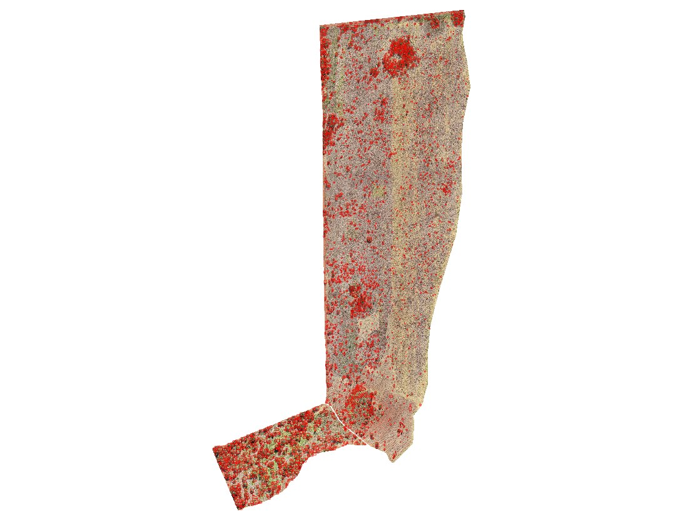
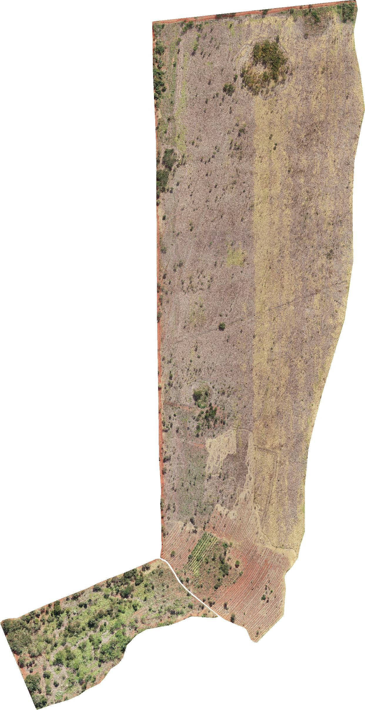
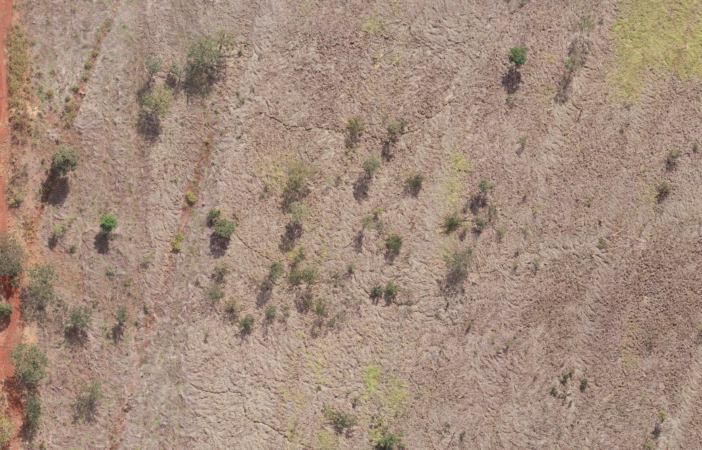
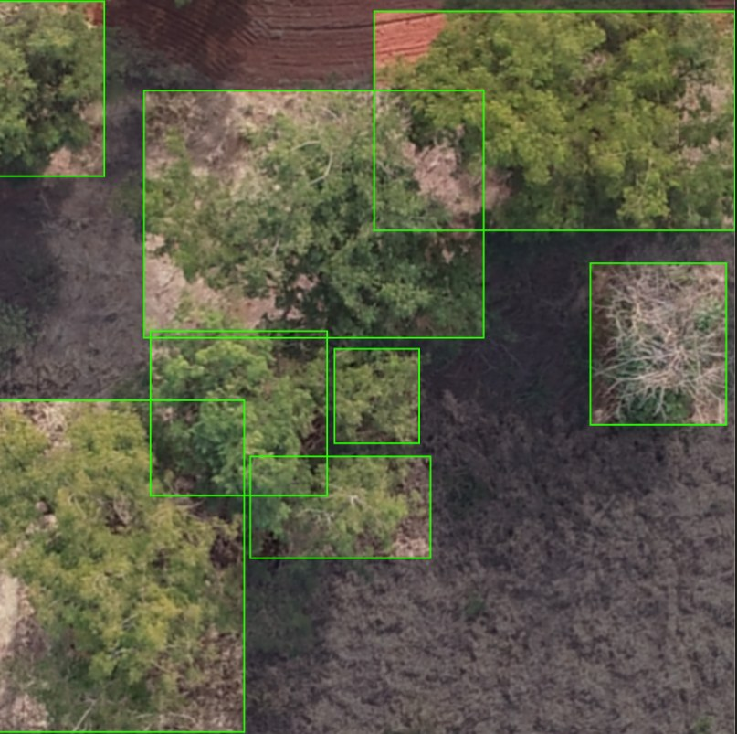
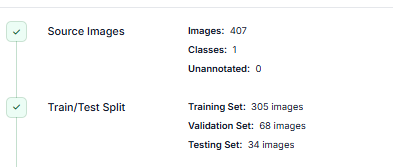
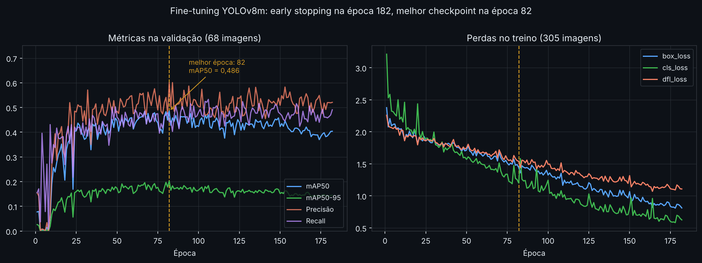
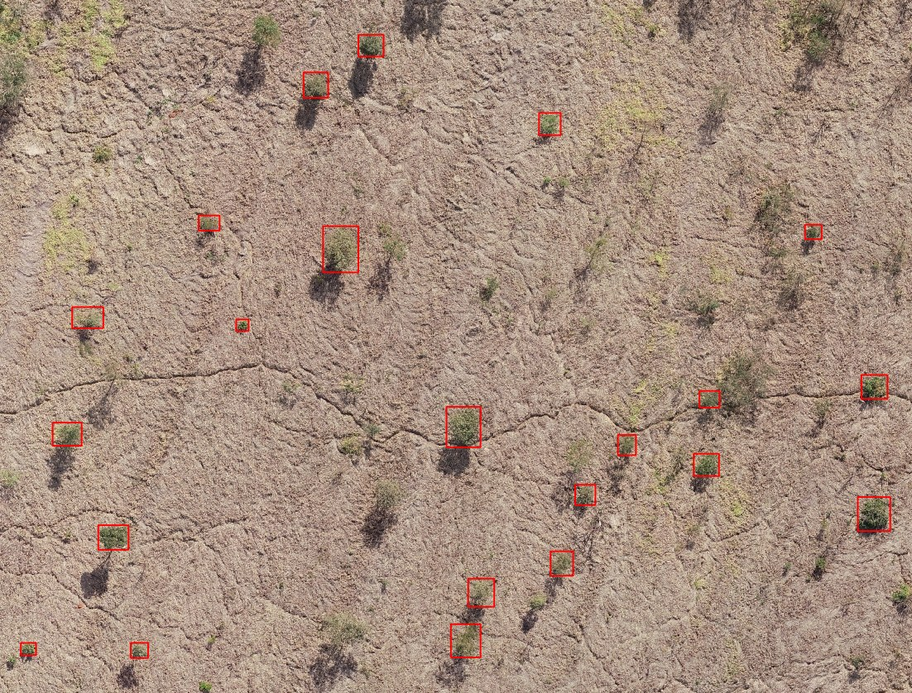
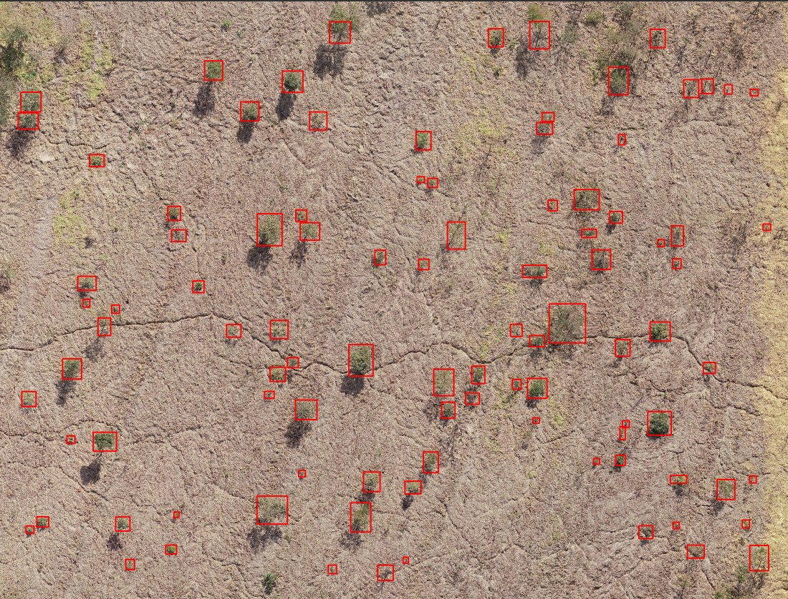

# 🌳 Detecção de árvores e arbustos em ortofoto de drone com YOLO

Detecção automática de árvores e arbustos pequenos e espalhados em **pastagem degradada**, a partir de uma ortofoto de drone de altíssima resolução (3,5 cm/pixel). O projeto usa **QGIS**, o plugin **Deepness** e um modelo **YOLOv8m ajustado (fine-tuning) com imagens anotadas da própria área**.


-F9AB00?logo=googlecolab&logoColor=white)



---

## Resumo

| | |
|---|---|
| **Problema** | Localizar e contar árvores e arbustos pequenos (muitos com 1 a 3 m de copa) numa ortofoto de mais de 860 milhões de pixels. Os modelos prontos, treinados em floresta densa, perdiam a maior parte deles. |
| **Abordagem** | Testei TreeEyed, GeoAI (DeepForest) e Deepness (Tree-Tops), corrigi problemas de escala e de formato do raster e, por fim, fiz fine-tuning de um YOLOv8m com 407 imagens anotadas da própria ortofoto. |
| **Resultado** | Na mesma área de teste, o modelo pronto detectou **22** árvores e o meu modelo detectou **105**. Na ortofoto inteira: **3.289 detecções** em cerca de **30 minutos de CPU**, direto no QGIS. |
| **Ferramentas** | QGIS · GDAL · Deepness · Roboflow · Google Colab (GPU T4) · Ultralytics YOLOv8 · ONNX |

---

## 1. O problema

A área é uma pastagem degradada, com vegetação arbórea e arbustiva **pequena e espalhada** sobre solo exposto e capim seco, além de algumas manchas de mata mais fechada.

<p align="center">
  
  &nbsp;&nbsp;
  
</p>

**Dados de entrada**

| Propriedade | Valor |
|---|---|
| Tipo | Ortofoto RGB de drone (GeoTIFF) |
| Resolução | ~3,5 cm/pixel |
| Dimensões | 21.068 × 40.885 pixels (~861 milhões de pixels, ~950 MB) |
| Bandas | 4 (RGB + canal alpha que marca a área imageada) |
| Área efetiva imageada | ~49,35 ha (46,5% dos pixels) |
| SRC | EPSG:31982 (SIRGAS 2000 / UTM 22S) |

> O GeoTIFF original, as anotações e as detecções vetoriais **não** são publicados, porque são dados de uma propriedade privada. As imagens deste README são recortes sem georreferência.

---

## 2. O processo

O projeto foi iterativo: cada ferramenta testada revelou um problema diferente, e cada problema ensinou algo sobre o seguinte.

### 2.1 TreeEyed: a escala da imagem

Primeiro teste, com o modelo HighResCanopyHeight. Além de os modelos precisarem ser baixados à parte, a documentação mostrou o problema de fundo: cada modelo pronto espera uma resolução muito diferente da minha imagem.

| Modelo | Resolução esperada |
|---|---|
| HighResCanopyHeight | 1 m |
| Mask R-CNN | 4,77 m |
| DeepForest | < 0,5 m (treinado em ~10 cm) |
| VHRTrees | 0,5 m |

Com 3,5 cm/pixel, a imagem estava fora da escala de todos eles.

### 2.2 GeoAI + DeepForest: ajustar parâmetros não bastou

Para o DeepForest:

1. **Reamostrei** a ortofoto de 3,5 cm para 10 cm/pixel (`Raster → Projeções → Deformar`).
2. **Gerei o GeoTIFF com blocos internos** (`TILED=YES`). Sem isso, o modo *Large Tile* falha com `Out-of-memory dataset is selected, but raster is not tiled`.
3. **Ajustei os parâmetros** num recorte de teste:

| Tentativa | Resultado |
|---|---|
| Patch Size 1100 (≈110 m de terreno por patch) | **3 detecções**: o modelo "via" a cena longe demais |
| Patch Size 440, Overlap 0,15, IoU 0,15, Score 0,30 | ~71 detecções, mas com árvores nítidas perdidas e caixas duplicadas |
| IoU 0,25 e Score 0,20 (os dois alterados juntos) | caiu para **36**, possivelmente por fusão de caixas vizinhas (hipótese não isolada) |

O DeepForest foi treinado em dossel florestal (dataset NEON). Arbustos pequenos em pasto não se parecem com o que ele aprendeu como "árvore", e nenhum parâmetro resolve isso.

### 2.3 Deepness + Tree-Tops Detection: o modelo certo, ainda sem os dados certos

O [Deepness](https://github.com/PUTvision/qgis-plugin-deepness) roda qualquer modelo ONNX dentro do QGIS. O modelo **Tree-Tops Detection** do Model Zoo dele (YOLOv9, entrada de 640 px, treinado em 10 cm/pixel) foi bem melhor que o DeepForest: pega as árvores médias e grandes, mas **ainda deixa passar a maior parte dos arbustos pequenos**.

**Conclusão:** para a vegetação específica dessa área, era preciso treinar com dados dela.

### 2.4 Fine-tuning com dados da própria área

#### Anotação (Roboflow)

- Tiles de 640 px exportados da ortofoto **na resolução original (3,5 cm)** pelo próprio Deepness (*Training data export*).
- Projeto privado de *Object Detection*, com uma única classe: `Tree`.
- A pré-anotação automática do Roboflow (SAM 3) **não gerou nenhuma caixa** nesse tipo de imagem, então **todas as anotações foram feitas à mão**.
- Regra seguida: anotar **todas** as árvores visíveis em cada tile, porque uma árvore sem caixa ensina o modelo que aquilo é fundo.



#### Dataset final (`deteccao-arvores-v3-merge`)

Foram várias rodadas de exportação e anotação de diferentes partes da mesma ortofoto, unidas num único dataset:

| Conjunto | Imagens |
|---|---|
| Treino | 305 |
| Validação | 68 |
| Teste | 34 |
| **Total** | **407** (1 classe, nenhuma imagem sem anotação) |



#### Treino (Google Colab, GPU gratuita)

O modelo final é a terceira rodada de treino: antes, testei YOLOv8n (dataset v1) e YOLOv8s (dataset v2), com menos imagens anotadas. O notebook está em [`notebooks/treino_yolov8_arvores.ipynb`](notebooks/treino_yolov8_arvores.ipynb).

```python
from ultralytics import YOLO

model = YOLO("yolov8m.pt")          # pré-treinado no COCO
model.train(
    data="dataset/deteccao-arvores-v3-merge.yolov9/data.yaml",
    epochs=200, imgsz=640, batch=16,
    device=0, workers=2, cache=True,
)
```

| Item | Valor |
|---|---|
| Modelo base | YOLOv8m (~25,9 M parâmetros) |
| GPU | Tesla T4 (Colab gratuito) |
| Ultralytics | 8.4.79 |
| Épocas | 182 de 200: parou por *early stopping* (100 épocas sem melhora) |
| Melhor época | **82** |



A perda de treino continua caindo até o fim, mas o mAP50 de validação para de melhorar por volta da época 82 e depois cai um pouco. Isso é **sobreajuste** (*overfitting*): o modelo começa a decorar o treino em vez de generalizar. Por isso o modelo usado é o checkpoint da época 82 (`best.pt`), e não o último, e por isso o próximo ganho virá de **mais dados anotados**, não de mais épocas.

**Exportação:** `best.pt` → `best_v3_merge_V2.onnx` → Deepness (*Detector type* `YOLO_Ultralytics`).

---

## 3. Resultados

### 3.1 Métricas de validação

Checkpoint `best.pt` (época 82), avaliado no conjunto de validação:

| Precisão | Recall | mAP50 | mAP50-95 |
|---|---|---|---|
| 0,604 | 0,442 | **0,486** | 0,201 |

**Como ler esses números:**
- **Precisão 0,60:** de cada 10 caixas que o modelo marca, cerca de 6 são árvores de verdade.
- **Recall 0,44:** ele encontra cerca de 44% das árvores anotadas à mão.
- **mAP50-95 mais baixo:** as caixas encontram a árvore, mas nem sempre com o contorno exato, o que é esperado para copas pequenas e de borda irregular.

### 3.2 Comparação na mesma área (143 × 95 m)

Os dois modelos rodaram no **mesmo retângulo** (1429 × 950 px a 10 cm), no mesmo plugin (Deepness) e com os mesmos parâmetros (Confidence 0,20 · IoU 0,30 · overlap 15%). Cada modelo rodou na resolução em que foi treinado (10 cm e 3,5 cm), e os resultados estão exibidos sobre a ortofoto original.

| Tree-Tops (pronto) | Meu modelo (fine-tuning) |
|---|---|
|  |  |
| **22 detecções** | **105 detecções** |
| Pega árvores médias e grandes; perde a maior parte dos arbustos pequenos. | Detecta muito mais vegetação pequena e espalhada; algumas caixas pequenas parecem ser falsos positivos. |

> **Mais detecções não significa mais acertos.** Essa comparação é visual e de contagem; a avaliação quantitativa do modelo é a da seção 3.1. As imagens mostram a visão do QGIS sobre a área, não o retângulo exato.
>
> <!-- VAZAMENTO: escreva aqui se o retângulo de comparação coincide ou não com tiles usados no treino --> 

### 3.3 Ortofoto inteira

| | |
|---|---|
| Detecções | **3.289** |
| Densidade | ~67 detecções por hectare (3.289 ÷ 49,35 ha) |
| Tempo | ~30 minutos em CPU (sem GPU), com o arquivo em disco local |
| Ferramenta | QGIS + Deepness, sem programação |

São **detecções do modelo, não uma contagem validada em campo**. A imagem do topo deste README mostra a distribuição delas: fica claro onde a vegetação se concentra e onde o pasto é mais aberto.

---

## 4. Como usar o modelo no QGIS

1. Instale o plugin **Deepness** no QGIS.
2. Baixe o `best_v3_merge_V2.onnx` na aba [**Releases**](../../releases) deste repositório.
3. Configure o Deepness:

| Campo | Valor |
|---|---|
| Model type | Detector |
| Detector type | `YOLO_Ultralytics` |
| Resolution [cm/px] | **3,5** (a resolução dos tiles de treino) |
| Tile size | 640 (fixo pelo modelo) |
| Tiles overlap | 15% |
| Confidence | 0,20 |
| IoU threshold | 0,30 |

### Teste rápido sem QGIS

```bash
pip install -r requirements.txt
python scripts/inferencia_onnx.py --modelo best_v3_merge_V2.onnx --imagem tile.png --saida resultado.png
```

O script roda o modelo num recorte PNG/JPG (idealmente de 640 px, a 3,5 cm/pixel) e desenha as caixas detectadas.

---

## 5. Lições aprendidas

- **A escala importa mais que os parâmetros.** Um modelo só funciona bem quando recebe a imagem na resolução em que foi treinado.
- **Patch Size depende da resolução.** 1100 px a 10 cm/pixel cobrem 110 m, quase 3 vezes a escala de treino do DeepForest. Resultado: 3 detecções.
- **GeoTIFF com blocos (`TILED=YES`)** é obrigatório para processar imagens grandes em pedaços.
- **Mude um parâmetro por vez.** Quando IoU e Score mudaram juntos, as detecções caíram de 71 para 36 e não deu para saber qual dos dois causou a queda.
- **Pré-anotação automática não é garantida.** O SAM 3 não reconheceu nada nesse tipo de imagem.
- **Para comparar modelos, fixe tudo menos o modelo:** mesma área, mesmo plugin e mesmos limiares.
- **A curva de validação mostra o limite.** Com 407 imagens, o modelo sobreajusta depois da época 82; mais dados anotados são o próximo ganho.

## 6. Limitações e próximos passos

- **Recall de 0,44:** parte das árvores muito pequenas ainda é perdida.
- **Falsos positivos:** algumas caixas pequenas parecem marcar solo ou galhos secos (observação visual, não quantificada).
- **Mata fechada:** onde as copas se encostam, várias árvores podem virar uma única caixa, então a contagem é menos confiável nessas manchas.
- **Uma única ortofoto:** treino e validação vêm da mesma área. Ainda não foi testado em outra propriedade, outra época do ano ou outro drone.
- **Próximos passos:** anotar mais imagens (principalmente de árvores pequenas e de mata fechada), validar a contagem em campo, testar em outras áreas e experimentar modelos menores (YOLOv8s / YOLO11s) para rodar mais rápido em CPU.

---

## Estrutura do repositório

```
├── README.md
├── requirements.txt
├── images/                 # figuras usadas neste README
├── docs/
│   └── parametros.md       # explicação de cada parâmetro testado
├── models/
│   └── README.md           # ficha técnica do modelo (download na aba Releases)
├── notebooks/              # notebook de treino no Google Colab
└── scripts/
    └── inferencia_onnx.py  # teste do modelo sem QGIS
```

## Licença

Código e modelo sob **AGPL-3.0**, a mesma licença do Ultralytics, usado no treino.

## Créditos

- [Deepness](https://github.com/PUTvision/qgis-plugin-deepness) e o modelo Tree-Tops Detection (PUT Vision)
- [DeepForest](https://github.com/weecology/DeepForest) (Weecology)
- [GeoAI](https://github.com/opengeos/geoai) (Qiusheng Wu)
- TreeEyed (plugin QGIS)
- [Ultralytics YOLO](https://github.com/ultralytics/ultralytics)
- [Roboflow](https://roboflow.com)
